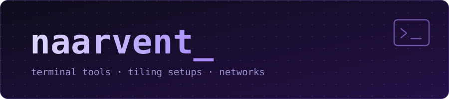

  

  Networking student in Spain. I build terminal tools, tiling setups and Linux desktops.

  
  
  

  

---

## Projects

### 🎧 [Spotify-TUI](https://github.com/naarvent/Spotify-TUI)

Keyboard-driven music client for the terminal. Spotify, YouTube Music and Subsonic/Navidrome in one interface, with offline downloads, a local library, synced and karaoke lyrics, and an audio visualizer.

  

`Python` `Textual`

### 🪟 [GlazeSnap](https://github.com/naarvent/GlazeSnap)

A Windows 11 desktop that behaves like a Linux tiling window manager: BSP tiling and mouse gestures on tiled windows, built on GlazeWM and AltSnap.

`PowerShell` `JavaScript`

---

## Currently

- Android development with Kotlin and Jetpack Compose
- Arch Linux + Hyprland, with my own rice manager
- Networking and systems coursework: GNS3, Active Directory, iptables
